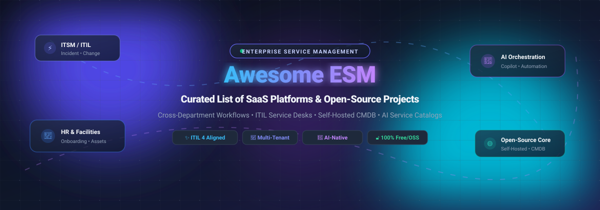
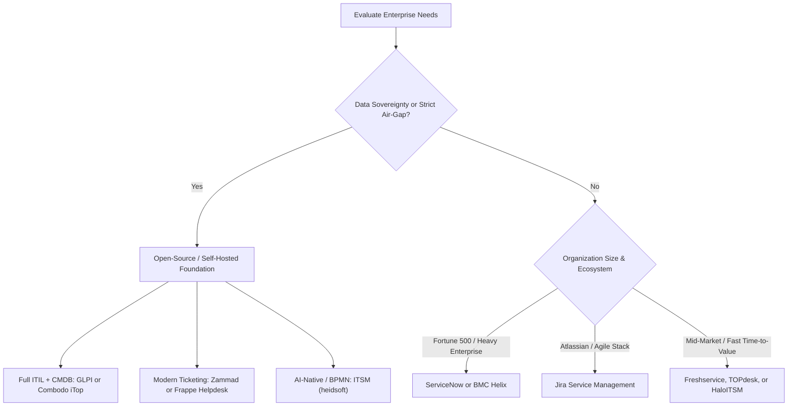

# Awesome-Enterprise-Service-Management-ESM 🚀

  

  <b>A curated catalog of top SaaS platforms and open-source GitHub projects powering Enterprise Service Management (ESM), IT Service Management (ITSM), self-hosted service desks, CMDB, and cross-department workflows.</b>

---

## 🧭 Table of Contents
- [📌 Overview](#-overview)
- [📊 Sector Overview & Market Dynamics](#-sector-overview--market-dynamics)
- [☁️ SaaS / Hosted Platforms](#️-saas--hosted-platforms)
- [💻 Open-Source GitHub Projects](#-open-source-github-projects)
- [💡 How to Choose Between SaaS and Open Source](#-how-to-choose-between-saas-and-open-source)
- [🤝 How to Contribute](#-how-to-contribute)
- [💖 Support](#-support)
- [📈 Star History](#-star-history)
- [⚖️ Disclaimer](#️-disclaimer)

---

## 📌 Overview

**Enterprise Service Management (ESM)** extends proven IT Service Management (ITSM and ITIL 4) principles beyond IT to business teams—including Human Resources (HR), Finance, Facilities, Legal, Procurement, and Operations. By centralizing request catalogs, incident routing, SLA tracking, and multi-department service automation into a unified digital workspace, ESM breaks down departmental silos and elevates employee experience.

This repository tracks the leading **enterprise SaaS platforms** and production-ready **open-source alternatives** for organizations evaluating ITIL-aligned service desks, self-hosted CMDBs, and conversational AI orchestration.

---

## 📊 Sector Overview & Market Dynamics

The global **Enterprise Service Management (ESM)** and **IT Service Management (ITSM)** combined software market is estimated at **~$14.5 Billion to $16.8 Billion (2025–2026)** and is projected to surpass **$35 Billion to $50 Billion by the early 2030s** at an estimated CAGR of 13–16%. 

The enterprise tier is **highly concentrated and dominated by an oligopolistic group of platform giants**—led overwhelmingly by ServiceNow along with Atlassian and BMC—which command the vast majority of Fortune 500 contracts and multi-department shared service deployments. Concurrently, the mid-market and self-hosted ecosystem exhibits **moderate fragmentation**, where agile AI-first SaaS disruptors (Freshservice, SysAid, HaloITSM) and mature open-source foundations (GLPI, Snipe-IT, Zammad, Znuny) compete vigorously on data sovereignty, rapid deployment, and total cost of ownership.

---

## ☁️ SaaS / Hosted Platforms

*Below is a comparison of major enterprise SaaS ESM and ITSM platforms, sorted in descending order by company scale (market capitalization, valuation, or estimated annual revenue).*

| Product | Description | Scale (Market Cap / Valuation / Revenue) | Pricing (Starting Tier) | Free Tier / Trial Limits |
| :--- | :--- | :--- | :--- | :--- |
| **[ServiceNow](https://www.servicenow.com/)** | **The enterprise ESM benchmark.** Over 85% of Fortune 500 enterprises rely on ServiceNow. Enterprise Service Management extends ITSM workflows to HR, Finance, Legal, and Facilities with native generative AI, CMDB orchestration, and Flow automation. | **~$106 Billion Market Cap** (~$15.4B TTM Revenue) | Starts at **~$70 - $100/fulfiller/month** (Foundation tier; enterprise contract) | **Free Personal Developer Instance (PDI)**: 1 instance with full admin rights; hibernates after 10 days of inactivity, reclaimed if left inactive |
| **[Jira Service Management](https://www.atlassian.com/software/jira/service-management)** | **The most accessible enterprise ESM for Atlassian ecosystems.** Seamlessly enables business teams (HR, Legal, Facilities) to build drag-and-drop service portals with delegated permissions, Assets CMDB, and Rovo AI agents. | **~$38 - $40 Billion Market Cap** (~$6.6B TTM Revenue) | **$0/month** (Free Plan); Standard starts at **$22.05/agent/month** (billed monthly) or **$20/agent/month** (billed annually) | **Free plan forever**: up to 3 agents, unlimited customers, 2 GB file storage; **7 to 14-day free trial** for Standard and Premium tiers |
| **[Freshservice](https://www.freshworks.com/freshservice/business-teams/esm/)** | **AI-powered ESM with secure segmented workspaces.** Delivers multi-department service desks on a single instance with complete data segregation between HR, IT, and Finance. Powered by Freddy AI Agent for conversational ticketing. | **~$3.2 Billion Market Cap** (~$903M TTM Revenue) | Starter starts at **$19/agent/month** (billed annually) or **$29/agent/month** (billed monthly) | **14-day free trial** with full feature access (no credit card required); unlimited free end-users/requesters |
| **[BMC Helix ESM](https://www.bmc.com/)** | **AI-powered automation across IT and enterprise lines of business.** Delivers pre-built workflows for HR Service Management, Workplace Facilities, Security Operations, and low-code Business Workflows backed by BMC HelixGPT. | **~$2.1 - $2.3 Billion Revenue** (KKR Private Equity portfolio) | Starts at **~$114 - $115/named agent/month** (3-seat minimum; annual enterprise agreement) | **30-day proof-of-concept / evaluation trial** via sales authorization; trial environment purged upon conclusion |
| **[Cherwell / Ivanti Neurons for ITSM](https://www.ivanti.com/)** | **No-code ESM platform acquired by Ivanti in 2021 (migrating to Ivanti Neurons for ITSM).** Features 11 built-in PINK-verified ITIL best practices, concurrent licensing for portal users, and hyper-automation bots. | **~$2.0 Billion Valuation** (~$700M - $780M Revenue; Clearlake / TA Associates) | Professional tier starts at **~$55 - $95/analyst/month** (billed annually under Ivanti enterprise contract) | **Custom sales-led PoC sandbox** (no self-serve public trial; Cherwell EOL December 2026, succeeded by Ivanti Neurons); unlimited self-service portal requesters |
| **[TOPdesk](https://www.topdesk.com/)** | **Ready-to-use ESM platform with rapid time-to-value.** Pragmatic ITIL-based shared service management across IT, Facilities, and HR. Works out of the box with customizable workflows without requiring software developers. | **~$180 - $200 Million Revenue** (CVC Growth Funds backing) | Essential edition starts at **$76/operator/month** (billed annually) | **30-day free trial** with full operator and self-service access (no credit card required); unlimited free end-users |
| **[SysAid](https://www.sysaid.com/)** | **AI-first service management with zero-trust departmental segregation.** Gives IT, HR, Finance, and Legal private spaces with isolated knowledge bases, AI guardrails, and cross-team ticket passing. | **~$30 Million Funding** (~$20M Revenue; Israel Growth Partners) | Professional plan starts at **$89/agent/month** (billed annually) | **14-day free trial** with full platform capabilities (no credit card required); includes core AI Copilot features |
| **[InvGate Service Management](https://invgate.com/)** | **Intuitive no-code ITSM with AI automation and smart SLA routing.** Features Virtual Service Agent across Slack/Teams, automated incident assignment, and visual service catalog design. | **~$35 Million Growth Round** (~$30M - $43M Revenue; Riverwood Capital) | Starter plan starts at **$1,499/year** (~$125/month for up to 5 agents, or ~$25/agent/month) | **30-day free trial** with full access to Starter/Pro ticketing and self-service features; unlimited free end-users |
| **[TeamDynamix](https://www.teamdynamix.com/)** | **Convergence of ESM and Project Portfolio Management (PPM).** Optimized for mid-market organizations, public sector, and higher education needing cross-departmental collaboration and project prioritization. | **Acquired by Level Equity** (~$30 Million+ Revenue) | Starts at **~$400 - $450/technician/year** (~$33 - $38/technician/month; annual institutional agreement) | **Guided live demo and sales-scoped PoC sandbox** (no self-serve free trial); unlimited client/requester portal users |
| **[HaloITSM](https://haloitsm.com/)** | **Unified, fast-moving service management platform.** Delivers all-inclusive ITIL modules, configuration management, asset tracking, and service catalogs with single-pane visibility across departments. | **Bootstrapped / High-Growth Mid-Market Scale** | Starts at **$99/agent/month** (1–24 agents, billed annually; all features included) | **30-day free trial** with full access to all ITIL modules and AI features (no credit card required); unlimited free end-users |

---

## 💻 Open-Source GitHub Projects

*Open-source platforms provide critical benefits: full data sovereignty, zero per-seat licensing fees, on-premise air-gapped capability, and deep customization. Below is the curated list of top open-source service desk, asset management, and ITIL/ESM engines, sorted in descending order by GitHub stargazers count.*

| Project | Stars_Badge | Description | Primary Stack | License |
| :--- | :--- | :--- | :--- | :--- |
| **[Chatwoot](https://github.com/chatwoot/chatwoot)** |  | **Open-source customer and employee engagement suite.** Modern omni-channel shared inbox supporting live chat, email, WhatsApp, and API integrations. Excellent for cross-department request intake desks seeking a clean, Slack/Discord-like user experience. | Ruby on Rails, Vue.js | AGPL-3.0 |
| **[Snipe-IT](https://github.com/snipe/snipe-it)** |  | **The de facto open-source IT Asset Management (ITAM) and CMDB system.** Built specifically for enterprise asset tracking, hardware lifecycle, software licenses, accessories, and consumables. Integrates cleanly with help desks via REST API. | PHP, Laravel | AGPL-3.0 |
| **[GLPI](https://github.com/glpi-project/glpi)** |  | **Comprehensive open-source ITSM, ESM, and financial asset management platform.** Features full ITIL service desk (incidents, problems, changes), CMDB, project management, software license administration, and multi-entity administration. | PHP | GPL-3.0 |
| **[Zammad](https://github.com/zammad/zammad)** |  | **Modern, web-based open-source ticketing and customer/employee service desk.** Built by the founder of OTRS. Includes real-time audit trails, multi-channel intake (Email, Chat, SMS, Web), SLA management, LDAP/SSO, and customizable request fields. | Ruby on Rails, PostgreSQL | AGPL-3.0 |
| **[FreeScout](https://github.com/freescout-help-desk/freescout)** |  | **Super-lightweight open-source shared inbox and help desk.** Designed as a self-hosted alternative to Zendesk and Help Scout. Operates on 1–2 GB RAM with unlimited users, tickets, and multi-mailbox support. Modular ecosystem for custom business needs. | PHP, Laravel | AGPL-3.0 |
| **[Frappe Helpdesk](https://github.com/frappe/helpdesk)** |  | **Modern open-source service desk built on the Frappe framework and ERPNext.** Features SLA tracking with operational hours, automated round-robin routing, unlimited agents without seat fees, OAuth/OIDC, and tight integration with ERPNext records. | Python, Vue.js, Frappe | AGPL-3.0 |
| **[Combodo iTop](https://github.com/combodo/itop)** |  | **Open-source ITIL-compliant Service Management and Configuration Management Database (CMDB).** Built to handle complex IT infrastructures, service catalog mapping, incident/change impact analysis, and customer contract management. | PHP, MySQL | AGPL-3.0 |
| **[Znuny (OTRS Community Edition)](https://github.com/znuny/Znuny)** |  | **Battle-tested LTS fork of OTRS Community Edition.** Known for immutable, audit-proof ticket history and enterprise-grade SLA governance. Highly proven in regulated public sector, banking, and telecom deployments requiring strict compliance. | Perl, JavaScript | GPL-3.0 |
| **[OTOBO](https://github.com/rotheross/otobo)** |  | **Modern open-source ITSM portal forked from OTRS with enhanced UX.** Offers free downloadable ITSM packages including CMDB, visual process management, service catalogs, and customer portals with optional commercial enterprise support. | Perl, JavaScript | GNU GPL |
| **[ITSM (heidsoft)](https://github.com/heidsoft/itsm)** |  | **AI-native open-source ESM platform with modern full-stack architecture.** Covers ITIL service requests, incident/change management, CMDB, and BPMN process orchestration. AI embedded into triage, knowledge retrieval, and automated tool execution. | Go, Next.js, Docker | Apache-2.0 |

---

## 💡 How to Choose Between SaaS and Open Source

---

## 🤝 How to Contribute

Contributions are warmly welcomed! Help keep this ecosystem up-to-date by submitting pull requests:

1. 🍴 Fork the repository.
2. 🌿 Create a new feature branch (`git checkout -b feature/add-new-esm-tool`).
3. 📝 Update `README.md` following the existing tabular structure, ensuring specific starting prices and exact trial/free-tier limits are researched and verified.
4. 💾 Commit your changes (`git commit -m "Add [Tool Name] with pricing and trial limits"`).
5. 🚀 Push to your branch and open a Pull Request.

Please review [Awesome-Awesome-Awesome](https://github.com/ishandutta2007/Awesome-Awesome-Awesome) for curated awesome list guidelines.

---

## 💖 Support

If you find this curated Enterprise Service Management repository valuable, please consider supporting the project:

- ⭐ **Star this repository** on GitHub to help others discover it!
- 🍴 **Fork and share** it with your fellow IT leaders, DevOps engineers, and platform teams.
- ☕ **Sponsor / Buy me a coffee** on the [GitHub Sponsor Dashboard](https://github.com/sponsors/ishandutta2007) to help sustain ongoing research and maintenance.

Thank you for your generous support! 🙏

---

## 📈 Star History

---

## ⚖️ Disclaimer

- This is an independent, community-curated repository and is not affiliated with or endorsed by ServiceNow, Atlassian, Freshworks, BMC, or any mentioned vendor.
- Product specifications, pricing tiers, and trial policies change periodically; verify current quotes directly on the vendors' official websites before commercial commitment.
- Enterprise Service Management systems process employee personally identifiable information (PII) and sensitive cross-department data; ensure appropriate role-based access control (RBAC), multi-tenant segregation, and compliance with GDPR/HIPAA standards.

---

  <b>Built with ❤️ for IT leaders, service desk administrators, and enterprise platform architects extending service management beyond IT.</b>

